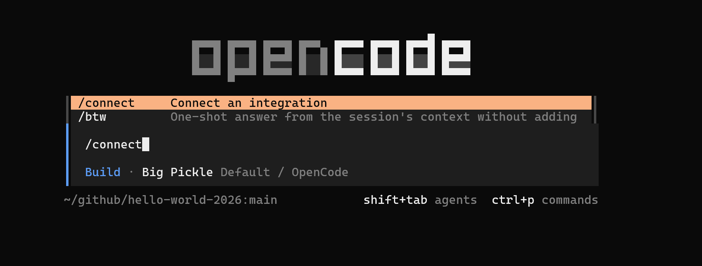
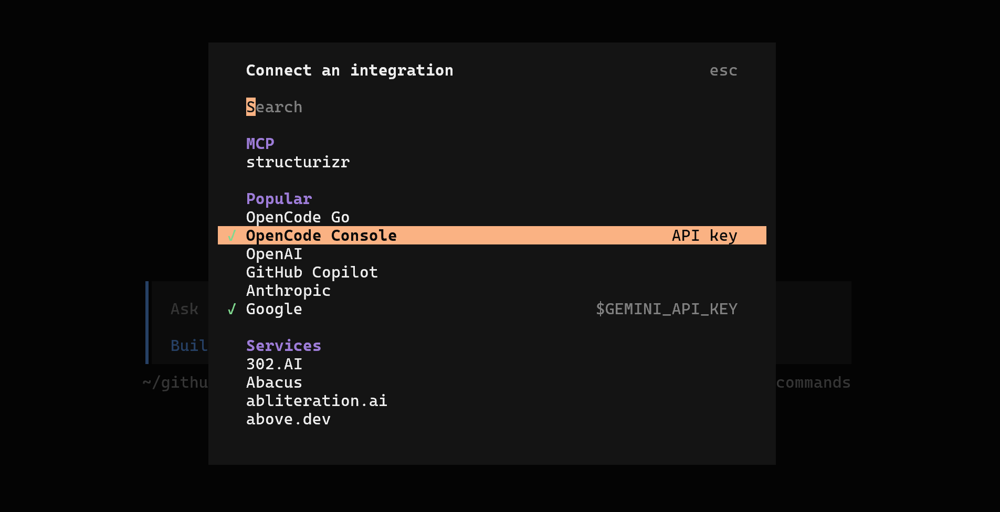
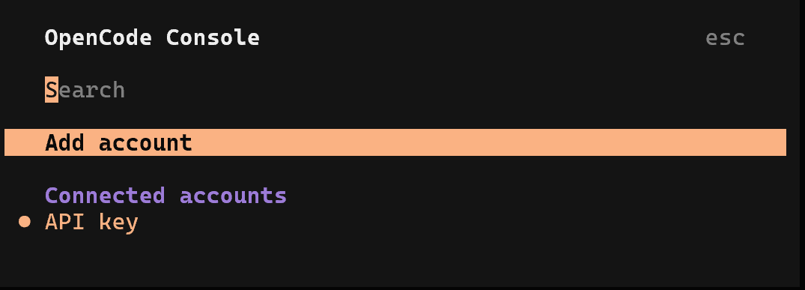
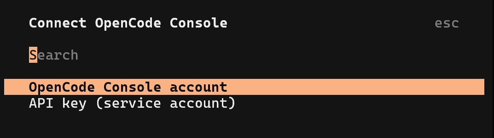
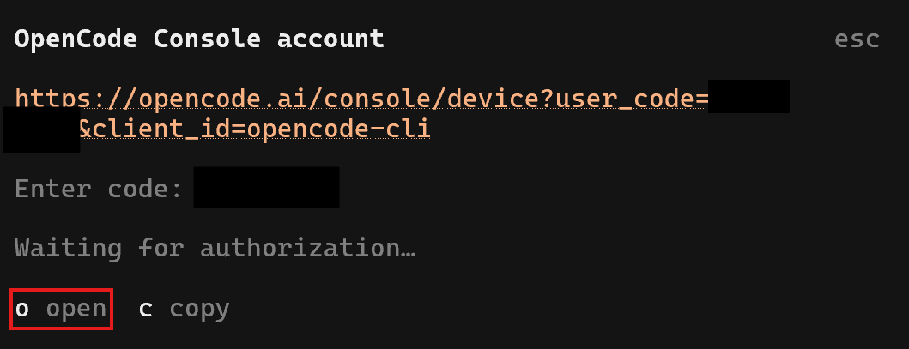
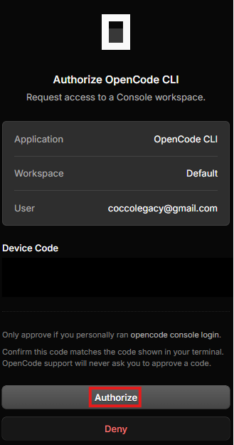
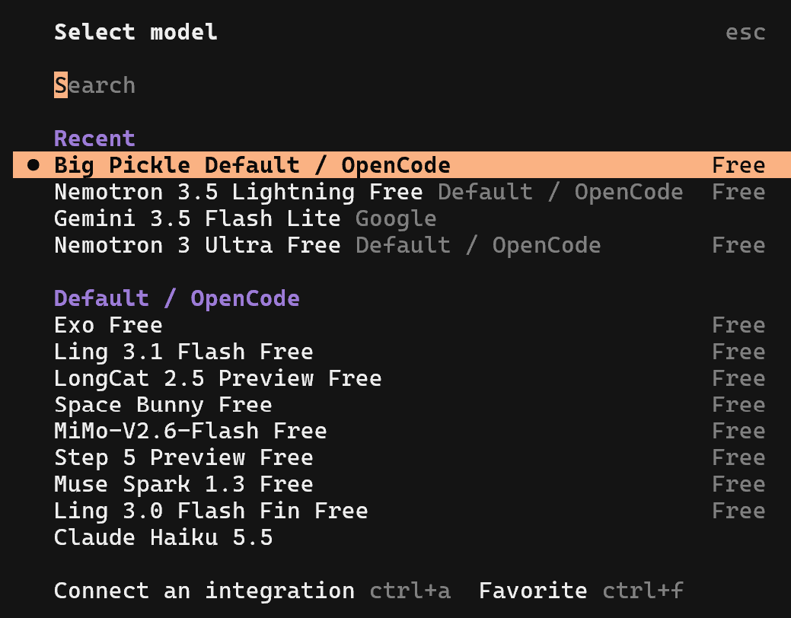

# OpenCode V2 環境安裝指南（Windows WSL／Linux／macOS）

這份文件讓你在工作坊開始前，把 **OpenCode V2 + Structurizr + VS Code** 的環境裝好，搭配《C4 架構工作坊》教學使用。只涵蓋三種環境：**Windows（WSL2）**、**Linux**、**macOS**。不涵蓋原生 Windows：OpenCode V2 官方文件目前寫明不支援 Windows 的套件管理器，所以 Windows 一律請在 WSL2 裡操作。

> **建議的工作方式：** 用 **VS Code** 當主要畫面，搭配 **OpenChamber** 擴充套件（在編輯器旁邊直接和 OpenCode 對話），再用 **Structurizr** 擴充套件讓 `.dsl` 檔有語法上色。

---

## 目錄

- [你要準備什麼](#你要準備什麼)
- [第一部分：依平台準備基礎環境](#第一部分依平台準備基礎環境)
- [第二部分：安裝 OpenCode V2 與工具（三個平台相同）](#第二部分安裝-opencode-v2-與工具三個平台相同)
- [最後檢查](#最後檢查)
- [疑難排解](#疑難排解)
- [備案：環境來不及裝好](#備案環境來不及裝好)
- [參考連結](#參考連結)

---

## 你要準備什麼

| 項目 | 用途 | 怎麼確認 |
| --- | --- | --- |
| Git | 取得教學 repo、每一步 commit | `git --version` |
| make | 教學的 `make up`、`make validate`、`make export` | `make --version` |
| curl、tar | OpenCode 安裝腳本需要 | `curl --version`、`tar --version` |
| Docker 或 Podman | 執行 Structurizr 檢視器與 MCP server | `docker version`（或 `podman version`） |
| OpenCode V2 | AI 程式協作助理 | `opencode --version`（應該是 `2.x`） |
| 模型存取 | OpenCode Console（免費） / OpenCode Go 帳號（付費），或你自己的 API key | 在 OpenCode 裡執行 `/models` |
| 模型存取 | OpenCode Go 帳號（含免費模型），或你自己的 API key | 在 OpenCode 裡執行 `/models` |
| VS Code 1.85 以上 | 編輯器，OpenChamber 的最低需求 | `code --version` |
| Node.js | **選用**：只有用 npm 安裝 OpenCode 時才需要 | `node --version` |

> 工作坊報名頁的自備清單有列 Node.js / npm。本文用官方安裝腳本（`curl`），**不需要 Node.js**；npm 只是另一種安裝方式（見步驟 1）。

**網路需求。** 公司網路或會場網路若有限制，請先確認下列網址連得到：

| 網址 | 用途 |
| --- | --- |
| `opencode.ai`、`registry.npmjs.org` | OpenCode 安裝腳本（從 npm registry 下載執行檔）、OpenCode Console 與 OpenCode Go 的 API |
| 你的模型供應商 API（只有用自己的 key 時） | 對話 |
| `github.com` | 下載教學 repo（SSH 需要 22 埠，被擋就改用 HTTPS） |
| `mcp.structurizr.com` | 託管版 Structurizr MCP（用本機版就不需要） |
| Docker Hub（`docker.io`） | 下載 `structurizr/structurizr`、`structurizr/mcp` 映像 |
| `raw.githubusercontent.com` | 教學的 Structurizr 主題（用網址引用） |
| `marketplace.visualstudio.com` | 安裝 VS Code 擴充套件 |

---

## 第一部分：依平台準備基礎環境

### Windows（WSL2）

**1. 啟用 WSL2。** 以系統管理員開啟 PowerShell：

```powershell
wsl --install
```

依指示重新開機並建立 Linux 使用者（預設會裝 Ubuntu）。之後確認版本是 2：

```powershell
wsl --update
wsl -l -v
```

`VERSION` 欄位必須是 `2`；如果是 `1`，執行 `wsl --set-version <發行版名稱> 2`。

**2. 安裝容器執行環境（二選一）。**

- **[Docker Desktop](https://www.docker.com/products/docker-desktop/)**（最簡單）：安裝後到 *Settings → Resources → WSL integration*，**打開你的 Linux 發行版**。
- 或直接在 WSL 裡安裝 Docker Engine，作法同下方 Linux。

在 **WSL 終端機**裡確認：

```bash
docker version
docker run --rm hello-world
```

**3. 安裝 VS Code（裝在 Windows 上）並加上 WSL 擴充套件。** 安裝 [VS Code](https://code.visualstudio.com/) 與 *WSL* 擴充套件（`ms-vscode-remote.remote-wsl`）。之後在 WSL 終端機裡用 `code .` 開啟專案，左下角會顯示 `WSL: Ubuntu`。

**4. 一律在 WSL 的 Linux 檔案系統裡工作。** 把 repo 放在 `~/work/`，**不要**放在 `/mnt/c/...`（跨檔案系統會很慢，檔案監看與換行也容易出問題）。

```bash
mkdir -p ~/work && cd ~/work
sudo apt update && sudo apt install -y git make curl tar
```

**5. 之後所有指令都在 WSL 終端機執行。** `make up` 啟動後，用 Windows 的瀏覽器開 <http://localhost:8080> 即可。

### Linux

**1. 安裝基本工具。**

```bash
# Debian / Ubuntu
sudo apt update && sudo apt install -y git make curl tar

# Fedora
sudo dnf install -y git make curl tar
```

**2. 安裝容器執行環境（二選一）。**

- **Docker Engine：** 依 [官方文件](https://docs.docker.com/engine/install/) 安裝，然後讓自己的帳號可以直接使用 docker，並**登出再登入**讓群組生效：

  ```bash
  sudo usermod -aG docker $USER
  docker run --rm hello-world
  ```

- **Podman：** `sudo apt install -y podman`（或 `sudo dnf install -y podman`）。repo 的 Makefile 支援 Podman：之後執行 `DOCKER=podman make up` 即可，不需要 `podman-docker`。

**3. 安裝 VS Code。** 到 [code.visualstudio.com](https://code.visualstudio.com/) 下載 `.deb` 或 `.rpm` 安裝，然後確認 `code --version`。

### macOS

**1. 安裝命令列工具**（含 git 與 make）：

```bash
xcode-select --install
```

**2. 安裝容器執行環境（擇一）。**

- **Docker Desktop**：到 [docker.com](https://www.docker.com/products/docker-desktop/) 下載安裝，並啟動一次。
- 或用 Homebrew：`brew install colima docker && colima start`
- 或 Podman：`brew install podman && podman machine init && podman machine start`（之後用 `DOCKER=podman make up`）

```bash
docker run --rm hello-world
```

**3. 安裝 VS Code。** `brew install --cask visual-studio-code`，或到官網下載。開啟 VS Code，按 `⇧⌘P`，執行 **Shell Command: Install 'code' command in PATH**，之後終端機才有 `code` 指令。

---

## 第二部分：安裝 OpenCode V2 與工具（三個平台相同）

> Windows 請在 **WSL 終端機**裡執行；以下指令都是 Linux / macOS 的 shell 指令。

### 1. 安裝 OpenCode V2

```bash
curl -fsSL https://opencode.ai/v2/install | bash
```

安裝腳本會把執行檔放到 `~/.opencode/bin/`，並把這個目錄加進你的 shell 設定檔（`~/.bashrc`、`~/.zshrc` 等）。**重新開一個終端機**（或 `source ~/.bashrc`／`source ~/.zshrc`），然後確認：

```bash
opencode --version      # 應該是 2.x
which opencode          # 應該是 ~/.opencode/bin/opencode
```

- 腳本會自動判斷作業系統、CPU 架構（x64／arm64），也會處理沒有 AVX2 的舊 CPU 與 musl（Alpine）；你不用自己挑。
- 想固定版本：`curl -fsSL https://opencode.ai/v2/install | bash -s -- --version <版本>`；不想動 shell 設定檔：加 `--no-modify-path`。
- 腳本也會附帶一個 `opencode2` 別名，和 `opencode` 是同一個程式。
- **npm 安裝（選用）：** `npm install -g @opencode/cli`（需要 Node.js，安裝後由 postinstall 選擇對應平台的執行檔）。**請不要裝 `opencode-ai`，那是舊的 V1（1.x）。**
- **如果 `opencode --version` 顯示 1.x**，代表你的 PATH 找到了舊版，用 `type -a opencode` 看有幾個，移除舊的或重新執行上面的安裝腳本。
- 解除安裝：先用 `opencode uninstall --dry-run` 預覽，再執行 `opencode uninstall`。

### 2. 連接模型

OpenCode 要連上模型供應商才能工作。可使用 **Opencode Console** 或 **OpenCode Go**（裡面有免費模型），也可以改用自己慣用 LLM 的 API key。

**Opencode Console：**
1. **輸入連接指令**：在 CLI 終端機介面中輸入 /connect 指令並按下 Enter，開始建立整合連接。

   

2. **選擇整合類型**：在「Connect an integration」選單中，找到並選擇 OpenCode Console。

   

3. **選擇新增帳號**：進入 OpenCode Console 選單後，選擇 Add account 來新增連結帳號。

   

4. **選擇帳號驗證方式**：在「Connect OpenCode Console」選單中，選擇 OpenCode Console account。

   

5. **開啟驗證連結**：系統會生成裝置驗證網址與驗證碼（Device Code），按下快捷鍵 o（或點擊 open）以開啟瀏覽器進行授權。

   

6. **完成網頁授權**：瀏覽器會開啟授權頁面，確認帳號與裝置碼正確後，點擊紅框處的 Authorize 按鈕進行授權。

   

7. **選擇模型**（Select model）：授權成功後回到終端機，在模型清單中選擇欲使用的預設模型（例如：Big Pickle Default / OpenCode）即可完成連接。

   

**改用自己的供應商。** `/connect` 選你的供應商（Anthropic、OpenAI、GitHub Copilot…），貼上 API key 或完成登入。若用環境變數提供 API key，要設在**執行模型請求的 server** 上，例如一次性的私有 server：

```bash
ANTHROPIC_API_KEY=sk-ant-... opencode --standalone
```

**確認模型真的通了**（不開畫面）：

```bash
opencode run "只回答一個字：ready"
```

### 3. 取得教學 repo

```bash
cd ~/work        # Windows 請在 WSL 的 Linux 檔案系統裡
git clone --branch init git@github.com:mansunkuo/hello-world-2026.git
cd hello-world-2026
git checkout -b main
git branch -M main
```

- **沒有設定 GitHub SSH key？** repo 是公開的，clone 那行改用 HTTPS 即可，其餘相同：`git clone --branch init https://github.com/mansunkuo/hello-world-2026.git`
- 這組指令從 `init` 分支開始，並在本機建立一個叫 `main` 的分支。**遠端的 `main` 是完成版**（含各步驟的參考解答與文件），請不要 `git pull origin main` 或切過去，否則你會直接看到答案。
- repo **已經包含**這些，你不需要另外建立：
  - `AGENTS.md`：規則檔（OpenCode V2 啟動時自動讀取，只認這個檔名）
  - `opencode.jsonc`：已設定好託管版 Structurizr MCP
  - `Makefile`：`make up`、`make validate`、`make export`、`make down`…
  - `structurizr/workspace.dsl`：起始範例

### 4. 確認 Structurizr MCP server

repo 的 `opencode.jsonc` 已經註冊好託管版 server，**不需要再執行 `opencode mcp add`**。在 repo 資料夾裡確認連得上就好：

```bash
opencode mcp list
```

清單裡應該看到 `✓ structurizr  connected`。

- 如果顯示 `needs authentication`，而你知道這個 server 不需要登入：OpenCode 預設對遠端 server 走 OAuth。在 `opencode.jsonc` 的 server 設定裡加上 `"oauth": false`（只是現場讓它能用的本機修改，不要 commit）：

  ```jsonc
  {
    "mcp": {
      "servers": {
        "structurizr": {
          "type": "remote",
          "url": "https://mcp.structurizr.com/mcp",
          "oauth": false
        }
      }
    }
  }
  ```

- 如果 server 真的需要登入，在 OpenCode 裡執行 `/mcps`，選該 server 並依提示登入。
- **想用本機版**（只綁本機、可離線；真實客戶專案建議用這個），啟動它，並把上面的 `url` 改成 `http://localhost:3000/mcp`：

  ```bash
  docker run -d --rm -p 127.0.0.1:3000:3000 -e PORT=3000 structurizr/mcp -dsl -mermaid
  ```

### 5. 預先下載映像

現場網路常常塞車，請先把映像下載好（Podman 把 `docker` 換成 `podman`）：

```bash
docker pull structurizr/structurizr:latest    # repo 的 Makefile 指定的映像，make up / validate / export 都用它
docker pull structurizr/mcp                   # 只有要用本機 MCP 時才需要
```

### 6. 安裝 VS Code 擴充套件

| 擴充套件 | ID | 用途 |
| --- | --- | --- |
| [OpenChamber](https://marketplace.visualstudio.com/items?itemName=FedaykinDev.openchamber) | `FedaykinDev.openchamber` | 在編輯器旁邊直接和 OpenCode 對話，支援選取程式碼右鍵詢問、一次比較多個模型 |
| [Structurizr](https://marketplace.visualstudio.com/items?itemName=ciarant.vscode-structurizr) | `ciarant.vscode-structurizr` | Structurizr DSL 的語法上色（只有上色，不含預覽或驗證） |

安裝（擇一）：在 VS Code 按 `Ctrl+P`（macOS 是 `⌘P`），貼上 `ext install FedaykinDev.openchamber` 後 Enter，再對第二個重複一次；或在終端機執行：

```bash
code --install-extension FedaykinDev.openchamber
code --install-extension ciarant.vscode-structurizr
```

- **Windows：** 請在 **WSL 視窗**（左下角顯示 `WSL: Ubuntu`）裡安裝，擴充套件才會裝進 WSL 端；在 WSL 終端機執行上面的 `code --install-extension` 就會裝對地方。
- **OpenChamber 需要 `opencode` 在 PATH 裡。** 它會自動啟動本機的 OpenCode；如果找不到，到 VS Code 設定把 `openchamber.opencodeBinary` 設成 `opencode` 的絕對路徑（例如 `/home/<你>/.opencode/bin/opencode`），並重新載入視窗。
- 常用指令（`Ctrl+Shift+P` / `⇧⌘P`）：`OpenChamber: Focus Chat`、`OpenChamber: New Session`、`OpenChamber: Show OpenCode Status`（排錯用）、`OpenChamber: Restart API Connection`。

### 7. 建議的工作畫面

- 左邊：`structurizr/workspace.dsl`（有語法上色）。
- 旁邊：OpenChamber 的對話面板，把教學的 prompt 貼在這裡。
- 瀏覽器：<http://localhost:8080>（`make up`），每次 agent 改完 DSL 就重新整理。
- 終端機：`make validate`、`git diff`、`git commit`。

---

## 最後檢查

在工作坊開始前，確認每一項都過了（Windows 在 WSL 終端機裡跑）：

- [ ] `git --version`、`make --version` 都有輸出
- [ ] `docker run --rm hello-world` 成功（或 Podman 的對應指令）
- [ ] `docker pull structurizr/structurizr:latest` 完成
- [ ] `opencode --version` 顯示 **2.x**，`which opencode` 指向 `~/.opencode/bin/opencode`
- [ ] `/models` 選到一個模型（例如 `opencode-go/...`），`opencode run "只回答一個字：ready"` 有回應
- [ ] repo 已 clone，`AGENTS.md`、`opencode.jsonc` 都在
- [ ] `opencode mcp list` 看到 `structurizr` 是 `connected`
- [ ] 在 repo 裡執行 `make up`，瀏覽器打開 <http://localhost:8080> 看得到檢視器
- [ ] VS Code 裡 OpenChamber 面板能開、`.dsl` 檔有語法上色

## 疑難排解

| 你看到的現象 | 原因 | 怎麼解決 |
| --- | --- | --- |
| `opencode: command not found` | 新的 PATH 還沒載入 | 重開終端機，或 `source ~/.bashrc`／`source ~/.zshrc`；也可手動 `export PATH=$HOME/.opencode/bin:$PATH` |
| `opencode --version` 是 `1.x` | 裝到舊的 V1（例如用了 `npm i -g opencode-ai`），或 PATH 先找到舊版 | `type -a opencode` 看有哪些；改用上面的安裝腳本或 `@opencode/cli` |
| OpenCode 卡住、連不上 server | 背景 service 異常 | `opencode service status`、`opencode service restart`；看日誌 `tail -f ~/.local/share/opencode/log/opencode.log` |
| `opencode mcp list` 顯示 `needs authentication` | 遠端 MCP 預設走 OAuth | 在 OpenCode 裡 `/mcps` 登入；若 server 不需要登入，設定 `"oauth": false`（見步驟 4） |
| MCP 一直連不上託管版 | 網路擋住 `mcp.structurizr.com` | 改用本機版 MCP（見步驟 4） |
| `permission denied` 連不到 Docker（Linux） | 帳號不在 `docker` 群組 | `sudo usermod -aG docker $USER`，登出再登入 |
| WSL 裡 `docker: command not found` | Docker Desktop 沒有對這個發行版開啟整合 | Docker Desktop → Settings → Resources → WSL integration，打開你的發行版 |
| WSL 裡檔案操作很慢、`make` 怪怪的 | repo 放在 `/mnt/c/...` | 把 repo 移到 `~/work/` 底下 |
| `8080` 被占用 | 別的程式在用這個埠（Makefile 把埠固定為 8080） | 用 `lsof -i :8080` 找出並關掉占用的程式；或先 `make down` 停掉舊的 Structurizr 容器 |
| 在 `/models` 看不到 OpenCode Go 的模型 | 還沒連接 Go，或 API key 不對 | 重新 `/connect` 選 OpenCode Go；確認 key 是從 OpenCode Console 複製的 |
| 選好的免費模型突然不見了 | 限時的 Preview 模型被下架或改版 | `curl https://opencode.ai/zen/go/v1/models` 看現在有哪些，改選另一個免費模型 |
| 對話中出現用量上限的訊息 | 達到 Go 的 5 小時、每週或每月上限 | 改用免費模型，或換成額度較大的便宜模型（見步驟 2 的表） |
| OpenChamber 找不到 OpenCode | VS Code 沒繼承到你的 PATH | 設定 `openchamber.opencodeBinary` 為絕對路徑並重新載入視窗（見步驟 6） |
| 安裝腳本下載失敗 | 公司網路擋住 `opencode.ai` 或 `registry.npmjs.org` | 改走允許的網路／代理，或請 IT 放行；實在不行見下方備案 |
| Apple silicon 拉映像時出現平台警告 | 映像與 CPU 架構不一致 | 這通常只是警告；若容器起不來，可在 `docker run` 加上 `--platform linux/amd64` 再試 |

## 備案：環境來不及裝好

- 用 [Structurizr Playground](https://playground.structurizr.com/) 搭配免費版的 Claude、ChatGPT 或 Gemini，輕度體驗教學內容（把 prompt 貼給網頁版 AI，把產生的 DSL 貼到 Playground 看圖）。
- 或請同組的人共用螢幕，一起操作。

## 參考連結

- [OpenCode V2 文件：安裝（Intro）](https://opencode.ai/v2/docs/#cli)
- [OpenCode V2：OpenCode Go](https://opencode.ai/v2/docs/console/go/)、[Providers](https://opencode.ai/v2/docs/providers/)
- [教學 repo（hello-world-2026）](https://github.com/mansunkuo/hello-world-2026)
- [OpenCode V2：MCP servers](https://opencode.ai/v2/docs/mcp-servers/)、[Instructions（AGENTS.md）](https://opencode.ai/v2/docs/instructions/)、[Providers](https://opencode.ai/v2/docs/cli/providers/)、[Troubleshooting](https://opencode.ai/v2/docs/troubleshooting/)
- [工作坊頁面：AI 驅動架構實戰：Structurizr × OpenCode](https://hwdc.ithome.com.tw/2026/lab/5031)
- [OpenChamber（VS Code）](https://marketplace.visualstudio.com/items?itemName=FedaykinDev.openchamber)、[Structurizr 語法上色（VS Code）](https://marketplace.visualstudio.com/items?itemName=ciarant.vscode-structurizr)
- [WSL 安裝說明](https://learn.microsoft.com/windows/wsl/install)、[Docker Engine 安裝](https://docs.docker.com/engine/install/)